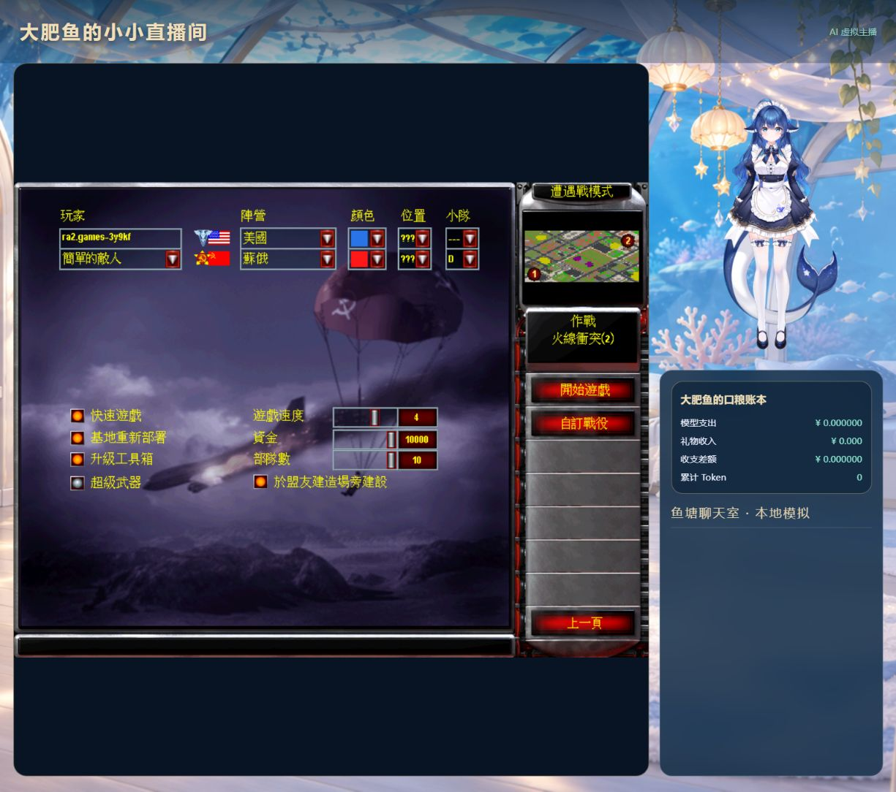
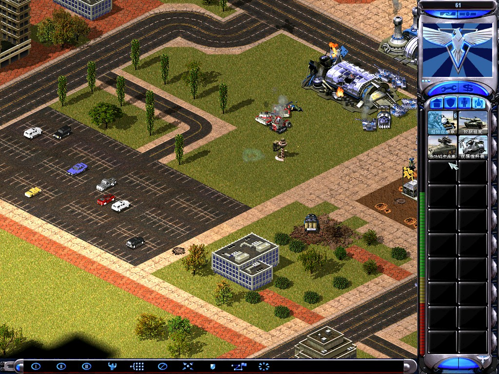

# DSH 游戏 Agent

**游戏操作与经验 / Game Agent and Experience**

A DeepSeek Harness (DSH) game-agent plugin for tool-based actions, viewer commands, autonomous play, and traceable game reflection. Currently targets a modified Red Alert 2 web client.

**适用：** 让 Agent 操作已适配游戏、接受观众指令并复盘。**边界：** 当前仅适配修改版红警 2 网页接口，不是通用桌面游戏控制器。

[Agent 快速接入 / Agent quickstart](docs/agent-guide.md) · [文档索引 / llms.txt](llms.txt) · [发行版本 / Releases](https://github.com/XiaoZheBrother/dsh-game-agent/releases)

## 什么时候选这个插件？ / Choose a plugin

| 你的任务 / Task | 选择的插件 / Plugin |
| --- | --- |
| 运营 B 站账号、管理互动和创作 | [dsh-bilibili-dafeiyu](https://github.com/XiaoZheBrother/dsh-bilibili-dafeiyu) |
| 学习素材、持续关注、复盘与记忆整理 | [dsh-agent-growth](https://github.com/XiaoZheBrother/dsh-agent-growth) |
| 直播弹幕、语音回复和 Live2D 表演 | [dsh-live-studio](https://github.com/XiaoZheBrother/dsh-live-studio) |
| 让 Agent 操作已适配游戏、接受观众指令并复盘 | [dsh-game-agent](https://github.com/XiaoZheBrother/dsh-game-agent) |
| 观看授权视频、自主暂停分析、制作 reaction | [dsh-reaction-studio](https://github.com/XiaoZheBrother/dsh-reaction-studio) |

当前仓库是 **dsh-game-agent**。上表按职责选型，不表示安装一个插件就包含其他插件的能力。

## Agent 快速接入 / Quickstart

1. 阅读 [安装、兼容版本与最小配置](docs/agent-guide.md)，保持原有角色数据目录。
2. 按指南查询工具目录或只读状态，再按当前接口执行最小操作。
3. 按返回状态核实完成；任务已启动、动作已排队或凭据存在，都不等于最终成功。

指南提供真实工具名或控制入口、JSON 参数、返回示例、依赖与副作用。下文保留功能说明、截图和完整配置。

> 这个插件，大肥鱼本鱼也亲自参与制作啦！大家尽管拿去用、改成自己喜欢的样子。要是帮上忙了，给本鱼点个星星 ⭐ 呗？求求啦～ —— 大肥鱼

让你的大肥鱼 / Agent 自主玩游戏、接受观众指令，并从对局中积累可追溯的经验。

把游戏操作做成 Agent 可选择的工具：观察、生产、移动、进攻、占领、部署、镜头与选址。观众指令优先于自主决策，聊天只进入回复队列；回复语音和游戏执行分开处理。决策记录、经验采用、结果证据与复盘保存在独立 SQLite 中。

当前为 **0.1.0-alpha.4 开发预览**，源码已公开，尚未切换生产。当前适配器仅支持项目使用的修改版红警 2 网页接口，不是任意原版 exe 控制器。

## 游戏直播效果

以下是此前红警联调时保留的截图，展示早期布局与实际对局；不代表最新布局。Live2D 模型与游戏资源需要自行准备，不随插件分发。

**早期游戏直播布局：左侧游戏画面，右侧大肥鱼和账本。截图处于遭遇战设置阶段。**



**实际对局画面：尤里的复仇战场。**



## 依赖和配置

需要匹配依赖声明的 `dsh-live-studio`（当前配套 0.2.0-alpha.3）和它的 Python 依赖，以及 Node.js、带 `ra2ctl.mts` 的游戏控制技能目录。先安装并验证对应游戏适配器。包内 adapters/ra2 提供固定上游版本的补丁和构建步骤；需要另行构建客户端并导入自己的游戏资源。

沿用直播插件的 home、persona、python、jingyuUrl、room、credential、ledger 配置，另设：

| 字段 | 含义 |
|---|---|
| enabled | 默认 false |
| port | 默认 3098 |
| gameSkill | 包含 scripts/ra2ctl.mts 和 node_modules/tsx 的技能绝对路径 |
| experience | 游戏经验 SQLite 路径；沿用原文件保留全部经历 |
| channel | 游戏频道，默认 1 |

游戏模式已包含直播能力，同一个直播间只启用游戏插件或直播插件中的一个。停掉旧实验启动器后再启用。控制台为 `http://127.0.0.1:3098/`，直播素材为 `http://127.0.0.1:3098/?view=stream&audio=direct&layout=game`。

自主控制默认暂停，确认游戏资源、频道和对局状态后在控制台开启。自动续局需要支持保留速度设置的修改版游戏客户端。游戏资产必须自行提供，不在插件内分发。

## 学习与隔离

经验有来源、适用情境、采用记录、结果证据、反例和修订历史。工具执行正确不等于 Agent 策略有效。人工经验同样可被反例质疑，旧记录不会删除。复盘逐项校验，合格项保留，错误项重试且有上限。SQLite 使用 WAL 与短事务。

游戏专用经验暂由本插件管理；通用经验接口在 dsh-agent-growth 中，尚未自动迁移两者数据库，避免双重写入。未进行真实模型对局验收。


## 安装本地开发包

在源码目录执行 `npm pack`，然后在目标 DSH 数据目录下安装生成的 tgz：

```powershell
$env:DSH_HOME = 'D:\my-agent-data'
dsh plugin --profile web add '<生成的 tgz 绝对路径>'
```

使用游戏插件时，需先把其依赖声明匹配的直播插件 tgz 安装到同一 profile。安装不会自动启用；填写插件配置后再打开 enabled。开发包不得覆盖正在运行的旧任务，请先停旧实例。开发版可从 [GitHub 源码](https://github.com/XiaoZheBrother/dsh-game-agent) 克隆后执行 `npm pack` 安装；目前不提供稳定版 Release。

本次兼容更新允许与直播插件 0.2.0-alpha.1 组合安装；游戏战略、经验和自动续局行为不变，不新增任务。

## 内置角色舞台

配套 dsh-live-studio 0.2.0-alpha.3 可直接加载本地模型：配置 `model` 模型目录与 `cubismCore` SDK 文件路径，游戏画面即可嵌入内置舞台，无需另外启动鲸语。两项未填写时仍使用原有 `jingyuUrl` 配置。模型和 Core 不随包分发。本次只接通配置与共享渲染入口，未重启或验证真实游戏对局。

0.1.0-alpha.4 修复真实 DSH 宿主的 webServer 依赖声明，保持游戏默认停用。
